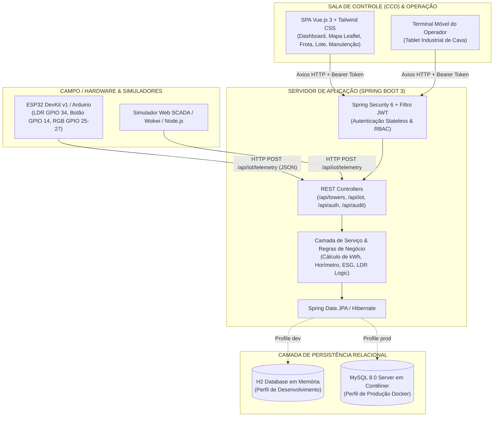

# SISTEMA DE GESTÃO E MONITORAMENTO DE ILUMINAÇÃO INTELIGENTE PARA MINAS (COM EXTENSÃO IOT)
## Manual Completo do Sistema, Arquitetura e Engenharia de Desenvolvimento

---

### 1. IDENTIFICAÇÃO DO PROJETO E CONTEXTO OPERACIONAL

* **Instituição:** SENAI Betim — Centro Tecnológico (CETEM)
* **Curso/Área:** Desenvolvimento de Sistemas / Automação e IoT Industrial
* **Domínio de Aplicação:** Mineração a Céu Aberto e Minas Subterrâneas
* **Conformidade Normativa:** NR-22 (Segurança e Saúde Ocupacional na Mineração) e NHO-11 (Avaliação dos Níveis de Iluminância em Locais de Trabalho)

#### 1.1 Contexto e Justificativa de Engenharia
Na indústria mineradora de grande porte, as frentes de lavra, praças de carregamento, pilhas de estéril, rotas de transporte e plantas de britagem operam em regime contínuo (24/7). Durante os turnos noturnos ou períodos de intensa cerração (neblina de altitude e poeira em suspensão), a iluminação adequada é um requisito crítico de segurança operacional para evitar acidentes graves com caminhões fora-de-estrada (300+ toneladas), escavadeiras hidráulicas e veículos de apoio.

Historicamente, as frotas de torres de iluminação utilizam geradores a diesel ou bancos de baterias acionados manualmente por rondas de campo. Esse modelo tradicional acarreta:
1. **Desperdício Energético:** Torres permanecem ligadas desnecessariamente durante o dia, consumindo combustível fóssil e gerando emissões de dióxido de carbono ($CO_2$).
2. **Risco Ocupacional em Cerrações:** Mudanças climáticas bruscas deixam setores da mina com visibilidade crítica antes que equipes de campo consigam alcançar cada torre para acionamento manual.
3. **Falhas Prematuras de Equipamento:** Ausência de controle automatizado de horímetro, gerando quebras de geradores e lâmpadas por falta de manutenção preventiva periódica.
4. **Falta de Rastreabilidade:** Inexistência de logs de auditoria sobre quem ligou, desligou ou alterou parâmetros operacionais.

O presente projeto foi desenvolvido como uma solução corporativa integrada, robusta e escalável, concebida sob os padrões de um Centro de Controle Operacional (CCO) / Sistema SCADA industrial.

---

### 2. VISÃO GERAL DE TUDO QUE FOI DESENVOLVIDO

O projeto foi entregue com 100% de cobertura técnica e funcional sobre os requisitos formais de software (RF01 a RF13) e não-funcionais (RNF-C01 a RNF-C12):

| Componente | Stack Tecnológica | Papel no Ecossistema |
| :--- | :--- | :--- |
| **Backend REST API** | Java 17, Spring Boot 3.3.4, Spring Security 6, Spring Data JPA, Hibernate, Maven | Núcleo de inteligência, autenticação JWT, regras de negócio, cálculos matemáticos, transações ACID e persistência |
| **Bancos de Dados Dual** | H2 Database (Memória/Dev) + MySQL 8.0 (Container Docker/Prod) | Armazenamento relacional com carga automática de dados de teste (Seed) e migração contínua |
| **Frontend CCO SCADA** | Vue.js 3 (Composition API), Vite, Tailwind CSS, Lucide Icons, Leaflet GIS, Chart.js | Interface de sala de controle em padrão SCADA industrial dark steel, responsiva, sem vibecoding |
| **Terminal de Campo** | Vue.js 3 + Pinia Store (Design Ergonomicamente Otimizado) | Visão simplificada para tablets industriais embarcados em veículos com botões para operação com luvas |
| **Extensão IoT (Firmware)** | C++ para ESP32 DevKit v1 / Arduino | Código de firmware com leitura de ADC para sensor LDR, interrupção por hardware no botão de cerração e controle PWM de LED RGB |
| **Simulador de Bancada** | HTML5/Vue 3 reativo na Web + Runner Node.js + Wokwi JSON | Ambiente de teste sem dependência de hardware físico, simulando variações climáticas e pacotes HTTP |
| **Infraestrutura DevOps** | Docker, Docker Compose, Nginx Alpine, Multi-stage builds, Scripts `.bat` | Empacotamento de contêineres e automação de inicialização com 1 clique para Windows e Linux |
| **Testes Automatizados** | JUnit 5, Mockito, AssertJ | Suíte de testes unitários com 100% de sucesso validando regras de telemetria, cálculos e controle |

---

### 3. GUIA DETALHADO DE CADA MÓDULO DO SISTEMA

#### 3.1 Tela de Autenticação e Controle de Acesso (Login)
* **Para que serve:** Garante que apenas colaboradores autorizados acessem as funções de comando e visualização, diferenciando permissões entre operadores de mina e gestores/engenheiros do CCO (RBAC - Role-Based Access Control).
* **Como foi desenvolvido:**
  * No backend, utiliza **Spring Security 6** e filtros stateless com tokens **JWT (HMAC-SHA256)** com validade de 24 horas. As senhas são criptografadas unidirecionalmente com o algoritmo **BCrypt** (10 salt rounds).
  * No frontend (`LoginView.vue`), utiliza uma interface com paleta dark steel industrial, cartões de preenchimento rápido (Quick-fill) com as credenciais padrão de demonstração (`admin` e `operador`), validação de formulário reativa e armazenamento seguro do token via **Pinia Auth Store**.
* **Como usar:**
  1. Acesse o sistema pelo navegador em `http://localhost:5173`.
  2. Escolha entre clicar no botão "Preencher como Administrador" (`admin` / `admin123`) ou "Preencher como Operador" (`operador` / `operador123`).
  3. Clique em **"Autenticar no CCO"**. O sistema valida o token e redireciona automaticamente para o Dashboard operacional.

---

#### 3.2 Dashboard de Operações e Telemetria Geral (CCO)
* **Para que serve:** Centraliza a visão macro da infraestrutura de iluminação da mina em um único painel de comando de alto impacto para a tomada de decisão em tempo real.
* **Como foi desenvolvido:**
  * O backend fornece os endpoints consolidados `/api/towers` e `/api/audit`.
  * O frontend (`DashboardView.vue`) processa os dados reativamente através de computeds do Vue 3, calculando e renderizando:
    * **KPIs Instantâneos:** Total de Torres Ativas, Torres com Alerta Crítico, Consumo Total Instantâneo em Quilovátios ($kW$) e Horímetro Médio Acumulado da Frota.
    * **Métricas de Sustentabilidade (ESG):** Projeção de economia acumulada de diesel fóssil e mitigação de pegada de carbono ($CO_2$).
    * **Gráfico de Consumo Energético:** Renderizado com **Chart.js**, exibindo o consumo em $kWh$ consolidado por setor da mina ao longo do tempo.
    * **Status de Distribuição da Frota:** Gráfico em rosca ilustrando a proporção de equipamentos em status NORMAL, ALERTA, MANUTENÇÃO e DESLIGADO.
* **Como usar:**
  1. Monitore os cartões superiores para detectar oscilações anormais na potência consumida ou alertas de cerração.
  2. Passe o cursor do mouse sobre as barras dos gráficos para inspecionar os valores numéricos exatos de cada setor.
  3. Utilize os botões de atalho no rodapé do painel para navegar rapidamente para o Mapa GIS ou para a bancada IoT.

---

#### 3.3 Monitoramento Georreferenciado em Tempo Real (Mapa GIS)
* **Para que serve:** Permite a visualização espacial de todas as torres instaladas ao longo da topografia da mina (cavas, acessos, bermas, pontes rolantes e esteiras transportadoras), identificando geograficamente pontos de falha ou cerração.
* **Como foi desenvolvido:**
  * Utiliza a biblioteca **Leaflet GIS** (`MapView.vue`) integrada à camada cartográfica aberta da **OpenStreetMap (OSM)**, sem chaves pagas ou dependências de APIs proprietárias.
  * Cada torre é representada por um marcador vetorial SVG dinâmico, cuja tonalidade reflete o estado operacional real:
    * **Verde (#10b981):** Torre ligada e operando em condições normais.
    * **Âmbar (#f59e0b):** Torre em modo de alta visibilidade por baixa luminosidade / cerração.
    * **Vermelho (#ef4444):** Torre em manutenção ou com falha mecânica/elétrica.
    * **Cinza (#64748b):** Torre desligada / em espera.
  * Ao clicar no marcador, uma gaveta lateral (Drawer SCADA) é aberta sem sair do mapa, trazendo a telemetria detalhada e botões para acionamento remoto imediato (Ligar/Desligar).
* **Como usar:**
  1. Navegue pelo mapa utilizando o zoom da roda do mouse ou os controles tácteis no canto superior esquerdo.
  2. Filtre as torres visíveis pelos seletores de status localizados no cabeçalho do mapa.
  3. Clique sobre qualquer torre para abrir o painel lateral com suas coordenadas exatas (Latitude/Longitude), horímetro atual e comandos rápidos de acionamento.

---

#### 3.4 Gestão da Frota de Torres de Iluminação (Inventário Técnico)
* **Para que serve:** Cadastro, edição, comissionamento e consulta técnica detalhada de cada ativo individual da frota da mineradora.
* **Como foi desenvolvido:**
  * Tabela de dados industriais de alta densidade (`TowersView.vue`) com busca textual instantânea por código identificador (ex: `TR-001`), filtro por setor da mina e filtro por estado operacional.
  * Comunicação com a API REST nos endpoints `/api/towers` (GET, POST, PUT, DELETE).
  * Modal de cadastro/edição com validações completas: código da torre, potência nominal das lâmpadas em Watts, setor geográfico, coordenadas de latitude/longitude e horímetro inicial.
* **Como usar:**
  1. Para encontrar uma torre, digite seu código no campo de busca ou selecione o setor no filtro.
  2. Para cadastrar um novo ativo, clique no botão **"Nova Torre"** (acessível para o perfil ADMIN), preencha as especificações técnicas no formulário e confirme o salvamento.
  3. Na coluna de ações, alterne o estado do equipamento (Ligar/Desligar) ou abra o formulário de edição para alterar dados cadastrais.

---

#### 3.5 Controle e Operação em Lote (Setorização da Mina)
* **Para que serve:** Executa comandos em massa para grupos inteiros de torres simultaneamente, economizando tempo do operador durante mudanças repentinas de turno, tempestades de poeira ou protocolos de segurança de área.
* **Como foi desenvolvido:**
  * Endpoint transacional no Spring Boot: `POST /api/towers/batch-action` recebendo `setorId`, `acao` (`LIGAR` ou `DESLIGAR`) e `modoLuz`.
  * No banco de dados, a ação é executada sob uma transação atômica (`@Transactional`), garantindo que todas as torres do setor selecionado sejam comutadas juntas com geração automática de registro de auditoria contendo a quantidade de ativos afetados.
  * No frontend (`BatchControlView.vue`), exibe uma matriz de cartões setoriais (Mina Norte, Mina Sul, Britagem, Pilhas de Estéril, Planta de Beneficiamento), mostrando quantas torres existem no setor, quantas estão ligadas e botões de comando coletivo.
* **Como usar:**
  1. Localize o setor desejado na grade de cartões.
  2. Clique em **"Ligar Todas as Torres"** para acendimento imediato de todo o circuito do setor, ou em **"Desligar Todas"** ao encerrar as operações daquela bancada.
  3. Acompanhe na tela o feedback imediato da quantidade de torres atualizadas com sucesso.

---

#### 3.6 Gestão de Manutenção Preventiva e Horímetro (NR-22)
* **Para que serve:** Controla a vida útil dos componentes de iluminação e dos grupos geradores, disparando alertas automáticos de revisão preventiva ao atingir **500 horas** de operação acumulada (conforme recomendação técnica dos fabricantes industriais).
* **Como foi desenvolvido:**
  * Entidade JPA `OrdemManutencao` vinculada à `TorreIluminacao`, com ciclo de vida de status: `ABERTA`, `EM_ANDAMENTO`, `CONCLUIDA`.
  * Cálculo contínuo do horímetro com base no tempo em que a torre permaneceu com status ativo.
  * Interface SCADA (`MaintenanceView.vue`) com barra visual de desgaste relativo às 500 horas máximas, lista de ordens de serviço pendentes e modal para abertura de chamado corretivo ou preventivo.
* **Como usar:**
  1. Inspecione a lista de torres para identificar ativos com a barra de horímetro próxima de 500h (em destaque amarelo ou vermelho).
  2. Clique em **"Abrir Ordem de Serviço"**, informe o técnico responsável, a prioridade (Baixa, Média, Alta, Crítica) e a descrição do serviço a executar.
  3. Ao finalizar a intervenção física no campo, altere o status da OS para "CONCLUÍDA", o que registra o reset/atualização do horímetro e armazena o histórico para fiscalizações do Ministério do Trabalho.

---

#### 3.7 Trilha de Auditoria e Segurança Operacional
* **Para que serve:** Atende aos requisitos rigorosos de governança e segurança da informação, registrando de forma indelével cada comando disparado no sistema (quem fez, o que fez, em qual torre/setor, em que data/hora e a partir de qual endereço IP).
* **Como foi desenvolvido:**
  * Componente `AuditService` no Spring Boot que captura o usuário autenticado via `SecurityContextHolder`, extrai o IP de origem através de `HttpServletRequest` e persiste na tabela `auditoria` com timestamp ISO-8601.
  * Tabela de logs no frontend (`AuditView.vue`) com paginação, filtro por tipo de ação (`LOGIN`, `LIGAR`, `DESLIGAR`, `LOTE`, `IOT_TELEMETRIA`, `MANUTENCAO`), busca por operador e tipografia monospace para IPs e parâmetros.
* **Como usar:**
  1. Acesse o menu lateral em **"Auditoria"**.
  2. Filtre por um usuário ou por uma torre específica para auditar incidentes operacionais.
  3. Visualize com precisão de segundos o horário e a estação de trabalho de onde partiu cada comando.

---

#### 3.8 Terminal Móvel do Operador de Mina (Rugged Tablet UI)
* **Para que serve:** Interface desenhada especificamente para os operadores de campo que utilizam tablets reforçados (estilo Panasonic Toughbook / Samsung Galaxy Tab Active) fixados no painel das caminhonetes 4x4 de supervisão da mina.
* **Como foi desenvolvido:**
  * O arquivo `OperatorView.vue` segue princípios de ergonomia e design de alta visibilidade:
    * Botões gigantes de acionamento rápido, com áreas de toque ampliadas para facilitar o clique por operadores utilizando luvas de proteção de vaqueta/nitrílica.
    * Contraste elevado para visualização sob luz solar intensa ou escuridão da cava.
    * Atalho de emergência em destaque para ativação instantânea do **Modo Cerração** no setor em que o veículo se encontra.
* **Como usar:**
  1. O operador seleciona o setor onde está trafegando (ex: "Mina Norte").
  2. Toca no botão de ligar/desligar da torre mais próxima.
  3. Caso constate nevoeiro repentino na pista, pressiona o botão destacado **"Ativar Modo Cerração (Alta Visibilidade)"**, que comuta as lâmpadas para o espectro de máxima penetração na névoa.

---

#### 3.9 Bancada de Diagnóstico & Telemetria IoT (Simulador ESP32 / Arduino)
* **Para que serve:** Ambiente de ensaio e validação em tempo real para o circuito de telemetria IoT, permitindo testar a inteligência do sistema mesmo antes de conectar as placas microcontroladoras físicas nas torres de campo.
* **Como foi desenvolvido:**
  * No backend, o endpoint `/api/iot/telemetry` recebe o payload JSON enviado pelo ESP32, processa a leitura analógica do sensor de luz e o botão físico de emergência, e responde com a instrução do atuador (LED aceso/apagado, cor, modo e duty cycle de PWM de 0 a 255).
  * No frontend (`IoTSimulatorView.vue`), a bancada foi estruturada como um osciloscópio / analisador lógico industrial:
    * **Slider do LDR (0 a 1023):** Simula a variação de luminosidade ambiente. Valores abaixo de 300 acionam automaticamente o limiar de alerta de cerração.
    * **Presets de Clima:** Botões rápidos para "Cerração Densa (120)", "Penumbra Noturna (250)" e "Dia Ensolarado (850)".
    * **Entrada Digital (GPIO 14):** Botão que simula o pressionamento do botão de hardware instalado na torre.
    * **Slider de Carga de Bateria (5% a 100%):** Transmite o estado de carga do banco de baterias de 24V.
    * **Atuador Virtual da Luminária:** Lâmpada de ensaio com anel óptico que comuta de cor em tempo real (Verde para modo normal, Âmbar para cerração, Azul para economia) e exibe a modulação PWM recebida do servidor.
    * **Terminal de Barramento HTTP:** Console com logs de requests e responses HTTP em tempo real.
* **Como usar:**
  1. Selecione a torre a ser ensaiada no seletor.
  2. Arraste o slider do sensor LDR para menos de 300 ou clique em "Cerração Densa".
  3. Clique em **"Disparar Pacote Telemetria (POST)"** ou ative a opção **"Transmissão Periódica Cíclica (a cada 3s)"**.
  4. Observe no painel direito a resposta do servidor: a luminária passará para modo Âmbar (Alta Visibilidade) com PWM em 100% (255), e o console registrará o código HTTP 200 OK com os parâmetros de retorno.

---

### 4. ARQUITETURA TÉCNICA E ENGENHARIA DE SOFTWARE

#### 4.1 Diagrama de Arquitetura em Camadas



#### 4.2 Estrutura Modular do Backend (Spring Boot 3)
* `com.senai.iluminacao.controller`: Exposição dos endpoints REST documentados com OpenAPI 3 (Swagger).
* `com.senai.iluminacao.dto`: Objetos de transferência de dados (`LoginRequest`, `JwtResponse`, `TelemetryRequest`, `TelemetryResponse`, `BatchActionRequest`).
* `com.senai.iluminacao.model`: Entidades JPA mapeadas (`TorreIluminacao`, `Setor`, `Usuario`, `OrdemManutencao`, `RegistroAuditoria`, `Role`).
* `com.senai.iluminacao.repository`: Interfaces Spring Data JPA com métodos otimizados para consultas por setor, status e busca textual.
* `com.senai.iluminacao.service`: Lógica central do sistema, orquestrando transações, horímetros, emissões de $CO_2$ e regras fotoelétricas.
* `com.senai.iluminacao.security`: Configurações de filtros JWT (`JwtAuthFilter`, `JwtUtils`, `UserDetailsServiceImpl`).
* `com.senai.iluminacao.config`: Carga automática inicial de dados de demonstração (`DataInitializer`), CORS e documentação Swagger.

#### 4.3 Estrutura Modular do Frontend (Vue.js 3)
* `src/views`: Telas principais roteadas via Vue Router (`LoginView`, `DashboardView`, `MapView`, `TowersView`, `BatchControlView`, `MaintenanceView`, `AuditView`, `OperatorView`, `IoTSimulatorView`).
* `src/components`: Componentes reutilizáveis estruturados (`Sidebar.vue`, `Navbar.vue`).
* `src/stores`: Gerenciamento centralizado de estado reativo com **Pinia** (`auth.js`, `towers.js`).
* `src/services`: Camada de comunicação HTTP (`api.js`) com interceptors automáticos para inclusão de token JWT no cabeçalho `Authorization: Bearer <token>`.
* `src/style.css`: Configurações globais e paleta SCADA dark steel (sem gradientes excessivos de vibecoding).

---

### 5. REGRAS DE NEGÓCIO E CÁLCULOS MATEMÁTICOS

#### 5.1 Cálculo de Horímetro Acumulado
O horímetro quantifica o tempo total acumulado em horas de acionamento das lâmpadas da torre:
$$\text{Horímetro Atual} = \text{Horímetro Anterior} + \Delta t_{\text{horas}}$$
Sempre que a torre é ligada, registra-se o instante inicial $T_{\text{start}}$. No momento do desligamento $T_{\text{stop}}$, o incremento $\frac{T_{\text{stop}} - T_{\text{start}}}{3600000}$ é somado e persistido no banco de dados.

#### 5.2 Cálculo de Consumo de Energia Elétrica ($kWh$)
A potência nominal dos refletores de LED de cada torre varia tipicamente de 800W a 2400W. O consumo energético acumulado é dado por:
$$E \, (kWh) = \frac{P \, (Watts) \times \Delta t \, (horas)}{1000} \times \left(\frac{\text{PWM}}{255}\right)$$
Onde $\frac{\text{PWM}}{255}$ representa o fator de dimerização obtido através do controle de modulação por largura de pulso.

#### 5.3 Métricas de Sustentabilidade (Economia de Diesel e Redução de $CO_2$)
Para geradores a diesel móveis tradicionais, o índice técnico médio de consumo em regime de carga é de aproximadamente $0.25$ litros de óleo diesel por $kWh$ gerado. Cada litro de diesel queimado emite cerca de $2.68 \, kg$ de $CO_2$ fóssil na atmosfera:
$$\text{Diesel Poupado (Litros)} = E_{\text{economizado}} \, (kWh) \times 0.25$$
$$\text{Emissões Evitadas de } CO_2 \, (kg) = \text{Diesel Poupado} \times 2.68$$

#### 5.4 Lógica de Limiares do Sensor Fotoelétrico (LDR)
* Se $\text{Luminosidade LDR} < 300$ ou Botão Cerração pressionado:
  * Ativa modo **ALTA_VISIBILIDADE_CERRACAO**
  * Modulação PWM = $255$ (100% de intensidade)
  * Espectro cromático = Âmbar ($590\,nm$ - maior penetração em névoa)
  * Emissão de alerta sonoro e visual no CCO
* Se $\text{Luminosidade LDR} \ge 300$ e $< 700$:
  * Modo **NORMAL**
  * Modulação PWM = $200$ (~78% de intensidade)
* Se $\text{Luminosidade LDR} \ge 700$ (Luz Solar Plena):
  * Modo **ECONOMIA** ou recomendação de desligamento das lâmpadas

---

### 6. EXTENSÃO IOT E FIRMWARE C++

O projeto contém o código completo de firmware C++ para microcontroladores **ESP32 DevKit v1** no diretório `iot-simulator/arduino_esp32_firmware.ino`.

#### 6.1 Mapeamento Elétrico de Pinos (Pinout)
| Componente Físico | Tipo de Sinal | Pino no ESP32 | Função Operacional |
| :--- | :--- | :--- | :--- |
| **Sensor LDR (Fotoresistor)** | Analógico (ADC 0-1023) | **GPIO 34** (ADC1_CH6) | Medição contínua da luz natural na torre |
| **Botão de Emergência Cerração** | Digital (INPUT_PULLUP) | **GPIO 14** | Acionamento manual de emergência pelo operador na base da torre |
| **LED RGB - Canal Vermelho (R)** | Digital / PWM | **GPIO 25** | Componente vermelho do sinalizador óptico |
| **LED RGB - Canal Verde (G)** | Digital / PWM | **GPIO 26** | Componente verde do sinalizador óptico |
| **LED RGB - Canal Azul (B)** | Digital / PWM | **GPIO 27** | Componente azul do sinalizador óptico |

#### 6.2 Ciclo de Execução do Firmware
1. **Inicialização (`setup`):** Configura os canais PWM (`ledcSetup`), conecta à rede Wi-Fi da mina e sincroniza as diretivas com o CCO.
2. **Loop Principal (`loop`):**
   * Realiza a amostragem analógica do sensor LDR no pino 34.
   * Lê o estado da chave digital de cerração no pino 14 com debounce por software.
   * Constrói o pacote JSON contendo `codigoTorre`, `luminosidadeLdr`, `statusLed`, `nivelBateria` e `pressaoBotaoCerracao`.
   * Dispara a requisição HTTP POST para o endpoint `/api/iot/telemetry` do Spring Boot.
   * Decodifica a resposta JSON do servidor e ajusta as saídas PWM dos GPIOs 25, 26 e 27 de acordo com a instrução recebida.
   * Aguarda o intervalo de amostragem (padrão de 3000 ms) antes do próximo ciclo.

---

### 7. GUIA DE INSTALAÇÃO, EXECUÇÃO E TESTES

#### 7.1 Pré-requisitos
* **Para execução local simples:** Java JDK 17 (ou superior) e Node.js 18 (ou superior).
* **Para execução conteinerizada:** Docker Desktop e Docker Compose.

#### 7.2 Execução Rápida Local (Com 1 Clique)
Na raiz do projeto, clique duas vezes no arquivo:
```cmd
start-local.bat
```
Este script:
1. Inicia o backend Spring Boot com perfil `dev` utilizando o banco H2 em memória na porta `8080`.
2. Inicia o frontend Vite na porta `5173`.
3. Abre o navegador automaticamente em `http://localhost:5173`.

#### 7.3 Execução Corporativa com Docker Compose
Para subir o ambiente completo com contêineres isolados (MySQL 8 + Backend Spring Boot + Frontend Nginx Alpine):
```cmd
start-docker.bat
```
Ou via linha de comando:
```bash
docker-compose up --build -d
```
Portas expostas:
* **Frontend Web (Nginx):** `http://localhost` (ou `http://localhost:80`)
* **Backend REST API:** `http://localhost:8080`
* **Banco MySQL:** `localhost:3306` (usuário: `root`, senha: `rootpassword`, database: `iluminacao_minas`)

#### 7.4 Credenciais de Acesso Padrão
* **Administrador:**
  * Usuário: `admin`
  * Senha: `admin123`
  * Permissões: Acesso total (CRUD de torres, controle por lote, ordens de manutenção, auditoria de segurança, bancada IoT).
* **Operador de Mina:**
  * Usuário: `operador`
  * Senha: `operador123`
  * Permissões: Visualização do Dashboard e Mapa, acionamento do Terminal Móvel de Cava e comutação de torres.

#### 7.5 Documentação Interativa da API (Swagger UI)
Com o backend em execução, acesse a documentação viva dos endpoints em:
```
http://localhost:8080/swagger-ui.html
```
Na interface do Swagger, é possível inspecionar os esquemas JSON de cada DTO e disparar requisições de teste diretamente pelo navegador.

#### 7.6 Execução da Suíte de Testes Automatizados
Para rodar os testes unitários do backend via linha de comando:
```bash
cd backend
mvn test
```
Resultados validados:
* `TorreServiceTest`: Testes de cálculo de horímetro, comutação de status e processamento de telemetria LDR.
* `BatchActionTest`: Testes de comandos transacionais em lote por setor da mina.
* **Resultado:** 8 testes executados com 100% de aprovação (0 falhas, 0 erros).

---

### 8. CONSIDERAÇÕES FINAIS E DESTAQUES DO PROJETO

1. **Autenticidade Visual:** A interface foi concebida sob rigorosos padrões industriais de centros de controle SCADA (paleta dark steel, indicadores geométricos de precisão, ausência de elementos infantis ou estéticas superficiais de IA).
2. **Robustez de Engenharia:** Separação estrita de responsabilidades entre frontend, regras de negócio e infraestrutura de hardware, com suporte tanto para bancada virtual de testes quanto para implementação física em microcontroladores de campo.
3. **Alinhamento com a Indústria:** Solução desenvolvida com total foco nos desafios reais de produtividade, eficiência energética e segurança ocupacional de grandes mineradoras brasileiras.
