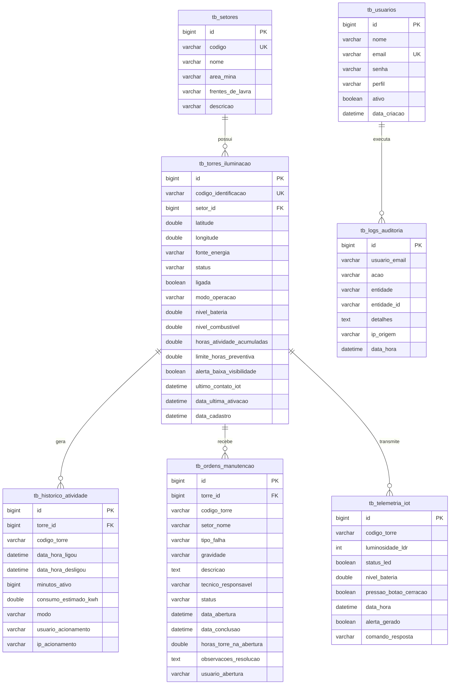

# Diagrama de Entidade-Relacionamento (DER) e Modelagem de Dados
**Projeto:** Sistema de Gestão e Monitoramento de Iluminação Inteligente para Minas  
**Instituição:** SENAI Betim (CETEM Maria Madalena Nogueira)  
**Item Exigido:** Documentação Técnica Exigida - Item 5.3  
**SGBD:** MySQL 8.x (com volume persistente no Docker) / H2 DB (Dev)

---

## 1. Diagrama Lógico de Entidade-Relacionamento (Mermaid)



---

## 2. Dicionário de Dados das Tabelas

### 2.1 Tabela `tb_usuarios`
Armazena as credenciais de acesso, perfil de segurança (RBAC) e status de ativação.
- `id` (BIGINT, PK, Auto Increment)
- `nome` (VARCHAR(100), NOT NULL)
- `email` (VARCHAR(120), UNIQUE, NOT NULL): Identificador único de login.
- `senha` (VARCHAR(255), NOT NULL): Hash BCrypt (fator 10+).
- `perfil` (VARCHAR(30), NOT NULL): Perfil de permissão (`ADMIN` ou `OPERADOR`).
- `ativo` (BOOLEAN, NOT NULL): Flag indicando se a conta está ativa.
- `data_criacao` (DATETIME, NOT NULL): Timestamp de criação do cadastro.

### 2.2 Tabela `tb_setores`
Representa os trechos e frentes de lavra da mina onde as torres móveis são alocadas.
- `id` (BIGINT, PK, Auto Increment)
- `codigo` (VARCHAR(50), UNIQUE, NOT NULL): Ex: `SET-01`, `SET-02`.
- `nome` (VARCHAR(100), NOT NULL): Ex: `Estrada de Escoamento - Trecho 04`.
- `area_mina` (VARCHAR(150)): Ex: `Via de Acesso Principal`.
- `frentes_de_lavra` (VARCHAR(200)): Ex: `Km 12 ao 18`.
- `descricao` (VARCHAR(255)): Informações operacionais sobre condições de poeira e traçado.

### 2.3 Tabela `tb_torres_iluminacao`
Entidade central do sistema contendo telemetria, coordenadas, parâmetros operacionais e horímetro contínuo.
- `id` (BIGINT, PK, Auto Increment)
- `codigo_identificacao` (VARCHAR(30), UNIQUE, NOT NULL): Código da torre (ex: `TR-001`).
- `setor_id` (BIGINT, FK -> tb_setores.id, NOT NULL): Vínculo com o setor.
- `latitude` (DOUBLE, NOT NULL) / `longitude` (DOUBLE, NOT NULL): Coordenadas GPS da torre na mina.
- `fonte_energia` (VARCHAR(30), NOT NULL): `PAINEL_SOLAR`, `GERADOR_DIESEL`, `BATERIA` ou `HIBRIDO`.
- `status` (VARCHAR(35), NOT NULL): `OPERACIONAL`, `ALERTA_BAIXA_VISIBILIDADE`, `EM_MANUTENCAO`, `FALHA_TECNICA` ou `DESLIGADA`.
- `ligada` (BOOLEAN, NOT NULL): Flag indicando se a luminária está acesa.
- `modo_operacao` (VARCHAR(35), NOT NULL): `NORMAL`, `ECONOMIA` ou `ALTA_VISIBILIDADE_CERRACAO`.
- `nivel_bateria` (DOUBLE, NOT NULL): Percentual de 0 a 100%.
- `nivel_combustivel` (DOUBLE, NULLABLE): Percentual de combustível (para geradores a diesel).
- `horas_atividade_acumuladas` (DOUBLE, NOT NULL): Horímetro total acumulado.
- `limite_horas_preventiva` (DOUBLE, NOT NULL): Limite de horas para a próxima manutenção (padrão 250h).
- `alerta_baixa_visibilidade` (BOOLEAN, NOT NULL): Disparado por sensor LDR ou cerração.
- `ultimo_contato_iot` (DATETIME): Data e hora da última telemetria do ESP32.
- `data_ultima_ativacao` (DATETIME): Horário em que a torre foi ligada pela última vez.
- `data_cadastro` (DATETIME, NOT NULL): Registro da criação da torre.

### 2.4 Tabela `tb_historico_atividade`
Registra as sessões de funcionamento de cada torre para consolidação do horímetro e cálculo de consumo energético em kWh (RF10).
- `id` (BIGINT, PK, Auto Increment)
- `torre_id` (BIGINT, FK -> tb_torres_iluminacao.id, NOT NULL)
- `codigo_torre` (VARCHAR(30), NOT NULL)
- `data_hora_ligou` (DATETIME, NOT NULL)
- `data_hora_desligou` (DATETIME, NULLABLE)
- `minutos_ativo` (BIGINT): Minutos transcorridos na sessão.
- `consumo_estimado_kwh` (DOUBLE): Consumo calculado com base no modo utilizado.
- `modo` (VARCHAR(35)): Modo vigente durante a operação.
- `usuario_acionamento` (VARCHAR(120)): E-mail do usuário que ligou a torre.
- `ip_acionamento` (VARCHAR(60)): IP de origem do comando.

### 2.5 Tabela `tb_ordens_manutencao`
Gestão dos chamados de falhas de campo e manutenções preventivas baseadas em horímetro (RF04).
- `id` (BIGINT, PK, Auto Increment)
- `torre_id` (BIGINT, FK -> tb_torres_iluminacao.id, NOT NULL)
- `codigo_torre` (VARCHAR(30), NOT NULL)
- `setor_nome` (VARCHAR(100))
- `tipo_falha` (VARCHAR(100), NOT NULL): Descrição resumida da ocorrência.
- `gravidade` (VARCHAR(20), NOT NULL): `BAIXA`, `MEDIA`, `ALTA`, `CRITICA`.
- `descricao` (TEXT, NOT NULL): Relato detalhado da pane ou necessidade preventiva.
- `tecnico_responsavel` (VARCHAR(100), NOT NULL): Nome do técnico designado.
- `status` (VARCHAR(25), NOT NULL): `PENDENTE`, `EM_ANDAMENTO`, `CONCLUIDA`, `CANCELADA`.
- `data_abertura` (DATETIME, NOT NULL) / `data_conclusao` (DATETIME, NULLABLE)
- `horas_torre_na_abertura` (DOUBLE): Horímetro da torre no momento do reporte.
- `observacoes_resolucao` (TEXT): Parecer técnico da conclusão do reparo.
- `usuario_abertura` (VARCHAR(120)): Usuário que abriu o chamado.

### 2.6 Tabela `tb_telemetria_iot`
Histórico de dados brutos enviados pelo microcontrolador ESP32/Arduino via requisição HTTP POST (RF06).
- `id` (BIGINT, PK, Auto Increment)
- `codigo_torre` (VARCHAR(30), NOT NULL)
- `luminosidade_ldr` (INT, NOT NULL): Leitura analógica (0 a 1023).
- `status_led` (BOOLEAN, NOT NULL): Estado da luminária.
- `nivel_bateria` (DOUBLE, NOT NULL)
- `pressao_botao_cerracao` (BOOLEAN, NOT NULL): Acionamento de botão manual.
- `data_hora` (DATETIME, NOT NULL)
- `alerta_gerado` (BOOLEAN, NOT NULL): Se ativou alerta de cerração.
- `comando_resposta` (VARCHAR(150)): Instrução enviada de volta ao hardware.

### 2.7 Tabela `tb_logs_auditoria`
Trilha de auditoria operacional e de gestão em conformidade com RF12 e RNF-W18.
- `id` (BIGINT, PK, Auto Increment)
- `usuario_email` (VARCHAR(120), NOT NULL)
- `acao` (VARCHAR(80), NOT NULL): `LIGAR_TORRE`, `DESLIGAR_TORRE`, `MODO_CERRACAO`, etc.
- `entidade` (VARCHAR(60), NOT NULL) / `entidade_id` (VARCHAR(60))
- `detalhes` (TEXT): Descrição textual da mudança de parâmetros.
- `ip_origem` (VARCHAR(60)): Endereço IPv4/IPv6 do cliente.
- `data_hora` (DATETIME, NOT NULL)

---

## 3. Script SQL DDL (Compatível com MySQL 8.x)

```sql
CREATE DATABASE IF NOT EXISTS iluminacao_minas CHARACTER SET utf8mb4 COLLATE utf8mb4_unicode_ci;
USE iluminacao_minas;

-- Tabela de Usuários
CREATE TABLE IF NOT EXISTS tb_usuarios (
    id BIGINT AUTO_INCREMENT PRIMARY KEY,
    nome VARCHAR(100) NOT NULL,
    email VARCHAR(120) NOT NULL UNIQUE,
    senha VARCHAR(255) NOT NULL,
    perfil VARCHAR(30) NOT NULL,
    ativo BOOLEAN NOT NULL DEFAULT TRUE,
    data_criacao DATETIME NOT NULL DEFAULT CURRENT_TIMESTAMP
) ENGINE=InnoDB;

-- Tabela de Setores da Mina
CREATE TABLE IF NOT EXISTS tb_setores (
    id BIGINT AUTO_INCREMENT PRIMARY KEY,
    codigo VARCHAR(50) NOT NULL UNIQUE,
    nome VARCHAR(100) NOT NULL,
    area_mina VARCHAR(150),
    frentes_de_lavra VARCHAR(200),
    descricao VARCHAR(255)
) ENGINE=InnoDB;

-- Tabela de Torres de Iluminação
CREATE TABLE IF NOT EXISTS tb_torres_iluminacao (
    id BIGINT AUTO_INCREMENT PRIMARY KEY,
    codigo_identificacao VARCHAR(30) NOT NULL UNIQUE,
    setor_id BIGINT NOT NULL,
    latitude DOUBLE NOT NULL,
    longitude DOUBLE NOT NULL,
    fonte_energia VARCHAR(30) NOT NULL,
    status VARCHAR(35) NOT NULL DEFAULT 'OPERACIONAL',
    ligada BOOLEAN NOT NULL DEFAULT TRUE,
    modo_operacao VARCHAR(35) NOT NULL DEFAULT 'NORMAL',
    nivel_bateria DOUBLE NOT NULL DEFAULT 100.0,
    nivel_combustivel DOUBLE NULL,
    horas_atividade_acumuladas DOUBLE NOT NULL DEFAULT 0.0,
    limite_horas_preventiva DOUBLE NOT NULL DEFAULT 250.0,
    alerta_baixa_visibilidade BOOLEAN NOT NULL DEFAULT FALSE,
    ultimo_contato_iot DATETIME NULL,
    data_ultima_ativacao DATETIME NULL,
    data_cadastro DATETIME NOT NULL DEFAULT CURRENT_TIMESTAMP,
    CONSTRAINT fk_torres_setor FOREIGN KEY (setor_id) REFERENCES tb_setores(id) ON DELETE RESTRICT
) ENGINE=InnoDB;

-- Tabela de Histórico de Atividade
CREATE TABLE IF NOT EXISTS tb_historico_atividade (
    id BIGINT AUTO_INCREMENT PRIMARY KEY,
    torre_id BIGINT NOT NULL,
    codigo_torre VARCHAR(30) NOT NULL,
    data_hora_ligou DATETIME NOT NULL,
    data_hora_desligou DATETIME NULL,
    minutos_ativo BIGINT DEFAULT 0,
    consumo_estimado_kwh DOUBLE DEFAULT 0.0,
    modo VARCHAR(35) NULL,
    usuario_acionamento VARCHAR(120) NULL,
    ip_acionamento VARCHAR(60) NULL,
    CONSTRAINT fk_historico_torre FOREIGN KEY (torre_id) REFERENCES tb_torres_iluminacao(id) ON DELETE CASCADE
) ENGINE=InnoDB;

-- Tabela de Ordens de Manutenção
CREATE TABLE IF NOT EXISTS tb_ordens_manutencao (
    id BIGINT AUTO_INCREMENT PRIMARY KEY,
    torre_id BIGINT NOT NULL,
    codigo_torre VARCHAR(30) NOT NULL,
    setor_nome VARCHAR(100) NULL,
    tipo_falha VARCHAR(100) NOT NULL,
    gravidade VARCHAR(20) NOT NULL DEFAULT 'MEDIA',
    descricao TEXT NOT NULL,
    tecnico_responsavel VARCHAR(100) NOT NULL,
    status VARCHAR(25) NOT NULL DEFAULT 'PENDENTE',
    data_abertura DATETIME NOT NULL DEFAULT CURRENT_TIMESTAMP,
    data_conclusao DATETIME NULL,
    horas_torre_na_abertura DOUBLE NULL,
    observacoes_resolucao TEXT NULL,
    usuario_abertura VARCHAR(120) NULL,
    CONSTRAINT fk_manutencao_torre FOREIGN KEY (torre_id) REFERENCES tb_torres_iluminacao(id) ON DELETE CASCADE
) ENGINE=InnoDB;

-- Tabela de Telemetria IoT
CREATE TABLE IF NOT EXISTS tb_telemetria_iot (
    id BIGINT AUTO_INCREMENT PRIMARY KEY,
    codigo_torre VARCHAR(30) NOT NULL,
    luminosidade_ldr INT NOT NULL,
    status_led BOOLEAN NOT NULL,
    nivel_bateria DOUBLE NOT NULL,
    pressao_botao_cerracao BOOLEAN NOT NULL DEFAULT FALSE,
    data_hora DATETIME NOT NULL DEFAULT CURRENT_TIMESTAMP,
    alerta_gerado BOOLEAN NOT NULL DEFAULT FALSE,
    comando_resposta VARCHAR(150) NULL
) ENGINE=InnoDB;

-- Tabela de Logs de Auditoria
CREATE TABLE IF NOT EXISTS tb_logs_auditoria (
    id BIGINT AUTO_INCREMENT PRIMARY KEY,
    usuario_email VARCHAR(120) NOT NULL,
    acao VARCHAR(80) NOT NULL,
    entidade VARCHAR(60) NOT NULL,
    entidade_id VARCHAR(60) NULL,
    detalhes TEXT NULL,
    ip_origem VARCHAR(60) NULL,
    data_hora DATETIME NOT NULL DEFAULT CURRENT_TIMESTAMP
) ENGINE=InnoDB;
```
