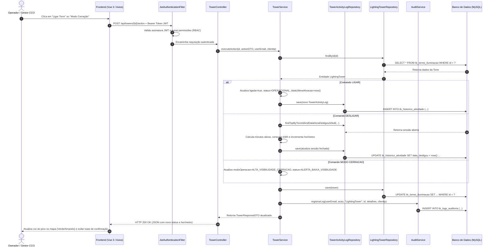
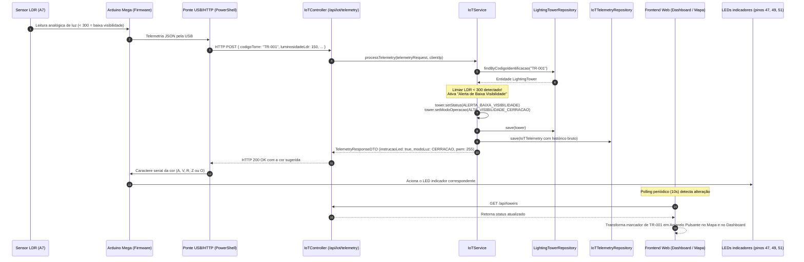
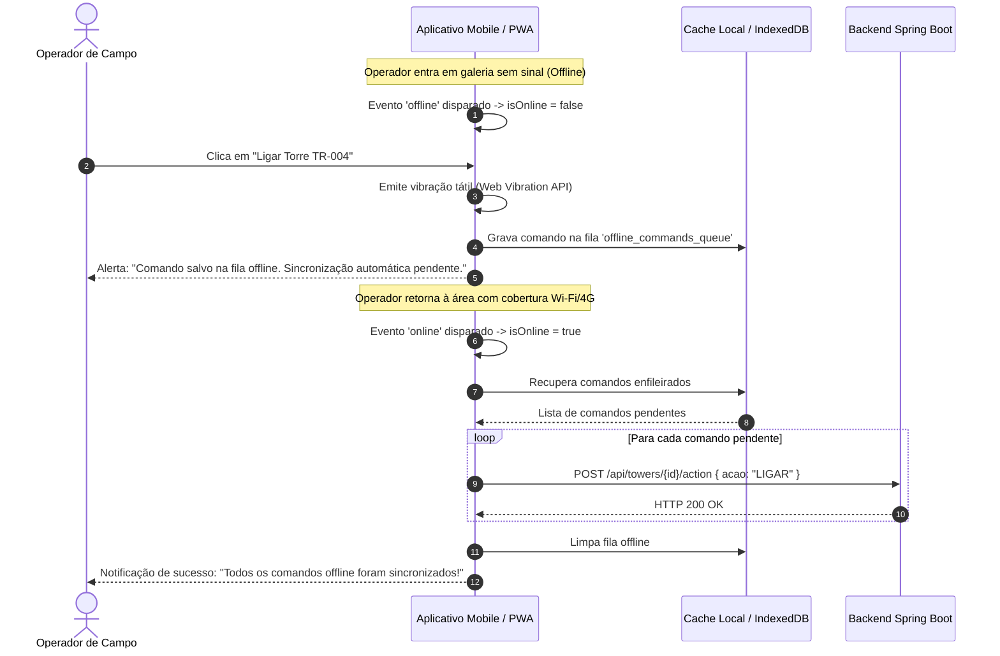

# Diagramas de Sequência da Aplicação
**Projeto:** Sistema de Gestão e Monitoramento de Iluminação Inteligente para Minas  
**Instituição:** SENAI Betim (CETEM Maria Madalena Nogueira)  
**Item Exigido:** Documentação Técnica Exigida - Item 5.4

---

## 1. Diagrama de Sequência: Envio de Comando de Alteração de Status da Torre
Representação da comunicação entre Frontend Vue 3, Backend Spring Boot 3 e Banco de Dados MySQL/H2 durante o acionamento de um comando operacional (ligar, desligar ou modo cerração):

---

## 2. Diagrama de Sequência: Automação IoT por Sensor de Luminosidade (Arduino Mega)
Demonstra o fluxo do circuito demonstrativo: o Arduino Mega lê o LDR e o botão, e uma ponte no computador encaminha a telemetria ao backend e retorna o comando dos LEDs:

---

## 3. Diagrama de Sequência: Operação Offline do Operador de Campo e Sincronização
Representa a tolerância a falhas e sincronização automática ao entrar e sair de áreas remotas sem sinal (RF13, RNF-A11, RNF-A14):

