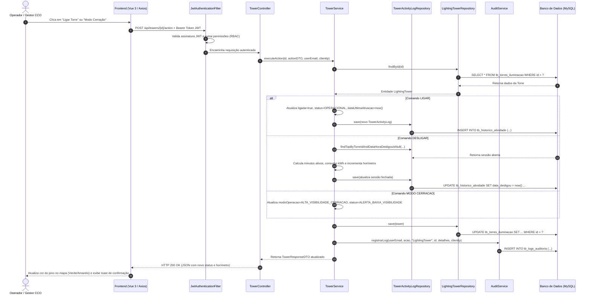
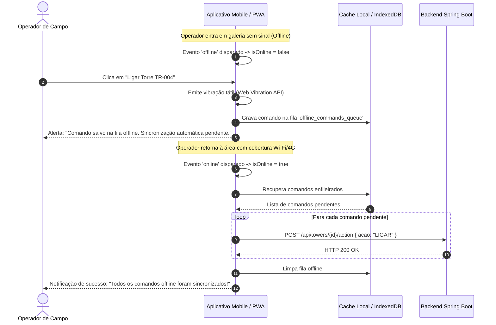

# Diagramas de Sequência da Aplicação
**Projeto:** Sistema de Gestão e Monitoramento de Iluminação Inteligente para Minas  
**Instituição:** SENAI Betim (CETEM Maria Madalena Nogueira)  
**Item Exigido:** Documentação Técnica Exigida - Item 5.4

---

## 1. Diagrama de Sequência: Envio de Comando de Alteração de Status da Torre
Representação da comunicação entre Frontend Vue 3, Backend Spring Boot 3 e Banco de Dados MySQL/H2 durante o acionamento de um comando operacional (ligar, desligar ou modo cerração):



---

## 2. Diagrama de Sequência: Automação IoT por Sensor de Luminosidade (LDR / ESP32)
Demonstra o fluxo automatizado da extensão IoT: o microcontrolador ESP32 detecta escuridão ou forte cerração na mina através do sensor LDR e envia telemetria ao backend, que altera o status da torre e responde com a instrução de acionamento do LED:

```mermaid
sequenceDiagram
    autonumber
    participant Sensor as Sensor LDR (GPIO 34)
    participant ESP32 as ESP32 / Arduino (Firmware / Simulador)
    participant API as IoTController (/api/iot/telemetry)
    participant IoTService as IoTService
    participant TowerRepo as LightingTowerRepository
    participant TelemetryRepo as IoTTelemetryRepository
    participant Frontend as Frontend Web (Dashboard / Mapa)
    participant LED as LED RGB da Luminária (GPIO 25, 26, 27)

    Sensor->>ESP32: Leitura analógica de luz (< 300 = escuridão/cerração)
    ESP32->>API: HTTP POST { codigoTorre: "TR-001", luminosidadeLdr: 150, ... }
    API->>IoTService: processTelemetry(telemetryRequest, clientIp)
    
    IoTService->>TowerRepo: findByCodigoIdentificacao("TR-001")
    TowerRepo-->>IoTService: Entidade LightingTower
    
    Note over IoTService: Limiar LDR < 300 detectado!<br/>Ativa "Alerta de Baixa Visibilidade"
    IoTService->>IoTService: tower.setStatus(ALERTA_BAIXA_VISIBILIDADE)<br/>tower.setModoOperacao(ALTA_VISIBILIDADE_CERRACAO)
    IoTService->>TowerRepo: save(tower)
    
    IoTService->>TelemetryRepo: save(IoTTelemetry com histórico bruto)
    
    IoTService-->>API: TelemetryResponseDTO (instrucaoLed: true, modoLuz: CERRACAO, pwm: 255)
    API-->>ESP32: HTTP 200 OK { instrucaoLed: true, modoLuz: "ALTA_VISIBILIDADE_CERRACAO", intensidadePwm: 255 }
    
    ESP32->>LED: ledcWrite(PWM_CH_RED, 255); ledcWrite(PWM_CH_GREEN, 140); (Cor Âmbar)
    
    Note over Frontend: Polling periódico (10s) detecta alteração
    Frontend->>API: GET /api/towers
    API-->>Frontend: Retorna status atualizado
    Frontend-->>Frontend: Transforma marcador de TR-001 em Amarelo Pulsante no Mapa e no Dashboard
```

---

## 3. Diagrama de Sequência: Operação Offline do Operador de Campo e Sincronização
Representa a tolerância a falhas e sincronização automática ao entrar e sair de áreas remotas sem sinal (RF13, RNF-A11, RNF-A14):


