# Diagrama de Classes da Aplicação
**Projeto:** Sistema de Gestão e Monitoramento de Iluminação Inteligente para Minas  
**Instituição:** SENAI Betim (CETEM Maria Madalena Nogueira)  
**Item Exigido:** Documentação Técnica Exigida - Item 5.5  
**Framework:** Java 17 + Spring Boot 3.x (Spring MVC, Spring Data JPA, Spring Security)

---

## 1. Visão Geral da Arquitetura em Camadas (Mermaid)

```mermaid
classDiagram
    direction TB

    %% Controllers
    class AuthController {
        -AuthService authService
        +login(LoginRequest, HttpServletRequest) ResponseEntity
        +register(RegisterRequest, HttpServletRequest) ResponseEntity
        +getMe(Authentication) ResponseEntity
    }

    class TowerController {
        -TowerService towerService
        +getAllTowers() ResponseEntity
        +getTowerById(Long) ResponseEntity
        +createTower(TowerCreateDTO, Authentication, HttpServletRequest) ResponseEntity
        +updateTower(Long, TowerUpdateDTO, Authentication, HttpServletRequest) ResponseEntity
        +deleteTower(Long, Authentication, HttpServletRequest) ResponseEntity
        +executeAction(Long, TowerActionDTO, Authentication, HttpServletRequest) ResponseEntity
        +executeBatchAction(BatchActionDTO, Authentication, HttpServletRequest) ResponseEntity
    }

    class IoTController {
        -IoTService ioTService
        +receiveTelemetry(TelemetryRequestDTO, HttpServletRequest) ResponseEntity
        +pollCommand(String) ResponseEntity
    }

    class MaintenanceController {
        -MaintenanceService maintenanceService
        +getAll(MaintenanceStatus) ResponseEntity
        +getById(Long) ResponseEntity
        +create(MaintenanceCreateDTO, Authentication, HttpServletRequest) ResponseEntity
        +update(Long, MaintenanceUpdateDTO, Authentication, HttpServletRequest) ResponseEntity
    }

    class DashboardController {
        -DashboardService dashboardService
        +getStats() ResponseEntity
    }

    %% Services
    class TowerService {
        -LightingTowerRepository towerRepository
        -TowerActivityLogRepository activityLogRepository
        -SectorService sectorService
        -AuditService auditService
        +getAllTowers() List~TowerResponseDTO~
        +getTowerById(Long) TowerResponseDTO
        +createTower(TowerCreateDTO, String, String) TowerResponseDTO
        +updateTower(Long, TowerUpdateDTO, String, String) TowerResponseDTO
        +deleteTower(Long, String, String) void
        +executeAction(Long, TowerActionDTO, String, String) TowerResponseDTO
        +executeBatchAction(BatchActionDTO, String, String) List~TowerResponseDTO~
        -ligarTorre(LightingTower, String, String) void
        -desligarTorre(LightingTower, String, String) void
        -alterarModoTorre(LightingTower, LightingMode, String, String) void
    }

    class IoTService {
        -LightingTowerRepository towerRepository
        -IoTTelemetryRepository telemetryRepository
        -AuditService auditService
        +processTelemetry(TelemetryRequestDTO, String) TelemetryResponseDTO
        +getHardwarePolling(String) HardwarePollingDTO
    }

    class MaintenanceService {
        -MaintenanceOrderRepository maintenanceRepository
        -LightingTowerRepository towerRepository
        -AuditService auditService
        +getAll(MaintenanceStatus) List~MaintenanceResponseDTO~
        +createMaintenance(MaintenanceCreateDTO, String, String) MaintenanceResponseDTO
        +updateMaintenance(Long, MaintenanceUpdateDTO, String, String) MaintenanceResponseDTO
    }

    class DashboardService {
        -LightingTowerRepository towerRepository
        -SectorRepository sectorRepository
        -TowerActivityLogRepository activityLogRepository
        -MaintenanceOrderRepository maintenanceRepository
        +getStats() DashboardStatsDTO
    }

    class AuditService {
        -AuditLogRepository auditLogRepository
        +registrarLog(String, String, String, String, String, String) void
        +getLogsRecentes() List~AuditResponseDTO~
        +getClientIp(HttpServletRequest)$ String
    }

    %% Entities
    class LightingTower {
        -Long id
        -String codigoIdentificacao
        -Sector setor
        -Double latitude
        -Double longitude
        -PowerSource fonteEnergia
        -TowerStatus status
        -boolean ligada
        -LightingMode modoOperacao
        -Double nivelBateria
        -Double nivelCombustivel
        -Double horasAtividadeAcumuladas
        -Double limiteHorasPreventiva
        -boolean alertaBaixaVisibilidade
        -LocalDateTime ultimoContatoIoT
        -LocalDateTime dataUltimaAtivacao
        -LocalDateTime dataCadastro
    }

    class Sector {
        -Long id
        -String codigo
        -String nome
        -String areaMina
        -String frentesDeLavra
        -String descricao
        -List~LightingTower~ torres
    }

    class TowerActivityLog {
        -Long id
        -LightingTower torre
        -String codigoTorre
        -LocalDateTime dataHoraLigou
        -LocalDateTime dataHoraDesligou
        -Long minutosAtivo
        -Double consumoEstimadoKWh
        -LightingMode modo
        -String usuarioAcionamento
        -String ipAcionamento
    }

    class MaintenanceOrder {
        -Long id
        -LightingTower torre
        -String codigoTorre
        -String setorNome
        -String tipoFalha
        -MaintenanceSeverity gravidade
        -String descricao
        -String tecnicoResponsavel
        -MaintenanceStatus status
        -LocalDateTime dataAbertura
        -LocalDateTime dataConclusao
        -Double horasTorreNaAbertura
        -String observacoesResolucao
        -String usuarioAbertura
    }

    class IoTTelemetry {
        -Long id
        -String codigoTorre
        -Integer luminosidadeLdr
        -Boolean statusLed
        -Double nivelBateria
        -Boolean pressaoBotaoCerracao
        -LocalDateTime dataHora
        -Boolean alertaGerado
        -String comandoResposta
    }

    class AuditLog {
        -Long id
        -String usuarioEmail
        -String acao
        -String entidade
        -String entidadeId
        -String detalhes
        -String ipOrigem
        -LocalDateTime dataHora
    }

    class User {
        -Long id
        -String nome
        -String email
        -String senha
        -Role perfil
        -boolean ativo
        -LocalDateTime dataCriacao
    }

    %% Relações
    TowerController --> TowerService
    IoTController --> IoTService
    MaintenanceController --> MaintenanceService
    DashboardController --> DashboardService
    AuthController --> AuthService

    TowerService --> LightingTower
    TowerService --> TowerActivityLog
    TowerService --> AuditService
    IoTService --> IoTTelemetry
    IoTService --> LightingTower
    MaintenanceService --> MaintenanceOrder
    MaintenanceService --> LightingTower

    Sector "1" *-- "many" LightingTower
    LightingTower "1" *-- "many" TowerActivityLog
    LightingTower "1" *-- "many" MaintenanceOrder
```

---

## 2. Descrição das Principais Classes do Backend

### 2.1 Camada de Controle (`controller`)
- **`AuthController`:** Gerencia as rotas de autenticação, validação de e-mail e senha, e emissão de tokens JWT para sessões de administradores e operadores.
- **`TowerController`:** Fornece os endpoints REST de gestão da frota (`GET`, `POST`, `PUT`, `DELETE /api/towers`), acionamento individual (`POST /api/towers/{id}/action`) e acionamento em lote por setor da mina (`POST /api/towers/batch`).
- **`IoTController`:** Recebe os payloads de telemetria enviados pelos dispositivos microcontrolados (`POST /api/iot/telemetry`) e atende as consultas de polling periódicas do hardware (`GET /api/iot/command/{codigo}`).
- **`MaintenanceController`:** Responsável pela abertura de chamados técnicos, tramitação de status de OS e resolução de manutenções.
- **`DashboardController`:** Agrega métricas de desempenho energético, economia gerada e contadores de frota para os gestores.
- **`AuditController`:** Expõe o histórico consolidado de auditoria (ações, datas, horários e IPs).

### 2.2 Camada de Negócio (`service`)
- **`TowerService`:** Encapsula as regras de acionamento das torres, encerramento de ciclos de atividade contínua, consolidação de consumo elétrico (kWh) e cálculo do horímetro acumulado para disparo de manutenção preventiva.
- **`IoTService`:** Avalia em tempo real os limiares analógicos do sensor LDR (`< 300`) e botão de cerração, alternando a torre para `ALERTA_BAIXA_VISIBILIDADE` e gerando as instruções para os atuadores LED.
- **`MaintenanceService`:** Controla a mudança de estado da torre para `EM_MANUTENCAO` quando uma falha é reportada e seu retorno a `OPERACIONAL` após o reparo.
- **`AuditService`:** Registra de forma transacional todas as operações críticas do sistema capturando o IP de origem a partir do `HttpServletRequest`.

### 2.3 Camada de Segurança (`security` & `config`)
- **`JwtTokenProvider`:** Cria, assina com HMAC SHA-256 e valida tokens JWT com validade de 24 horas.
- **`JwtAuthenticationFilter`:** Intercepta as requisições HTTP, extrai o Bearer token e injeta a identidade do usuário no `SecurityContext`.
- **`SecurityConfig`:** Define as políticas de CORS, CSRF, encriptação BCrypt (fator 10) e restrições RBAC baseadas nos papéis `ROLE_ADMIN` e `ROLE_OPERADOR`.
